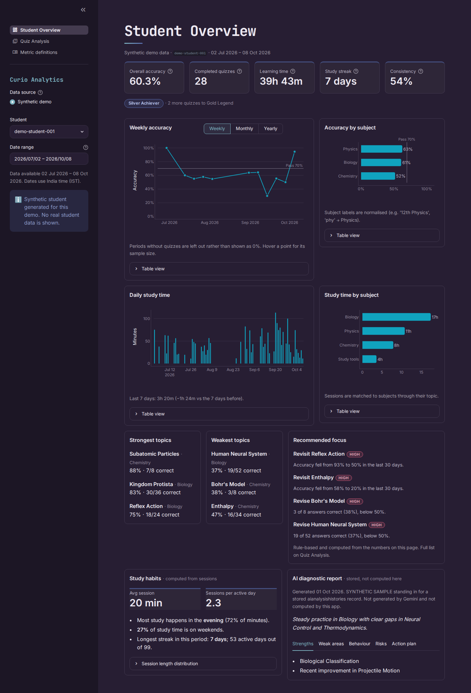
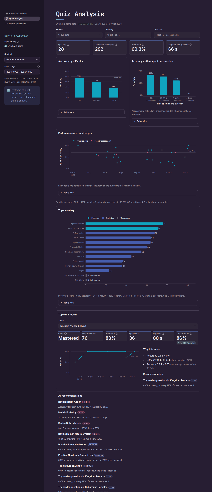

# Curio Student Analytics

An interactive dashboard that turns a student's quiz attempts, faculty assessments and study sessions
into explainable performance analytics: accuracy, progress over time, subject and topic breakdowns,
topic mastery, study habits and rule-based recommendations.

**Live demo: [curiostudentanalytics.streamlit.app](https://curiostudentanalytics.streamlit.app/)**

Built as a working prototype of the **Curio Student Analytics System** architecture
(MongoDB collections → analytics engine → structured results → dashboard), in Python and Streamlit.

> **Demo data is synthetic.** The public app shows one generated student. Real platform data is only
> used locally and never committed or deployed. See [Data & privacy](#data--privacy).



## Features

**Student Overview**
- KPIs: overall accuracy, completed quizzes and badge progress, learning time, study streak, consistency
- Weekly / monthly / yearly accuracy trend with the 70% pass line
- Accuracy by subject, daily study time, study time by subject
- Strongest and weakest topics, top recommendations
- Study habits computed from sessions (session length, time of day, weekend share)
- Stored AI diagnostic report, clearly labelled as stored text rather than calculated here

**Quiz Analysis**
- Filters for subject, difficulty and quiz type (practice / faculty assessment)
- Accuracy by difficulty, accuracy against time spent per question, accuracy of every attempt
- Practice vs assessment comparison
- Topic mastery chart (Mastered / Exploring / Unexplored)
- Topic drill-down: score breakdown, recent trend, attempt history and the reason for its recommendation
- The full recommendation list

**Metric definitions** documents every formula and where each rule comes from.

Every chart has hover details and a table view, and every page handles empty periods without crashing
or showing misleading zeros.

## Run it locally

```bash
python -m venv .venv && source .venv/bin/activate     # Windows: .venv\Scripts\activate
pip install -r requirements.txt
streamlit run app.py
```

Optional, on an approved machine only: point the app at the real export to switch data sources in the sidebar.

```bash
CURIO_DATA_DIR=/path/to/analytics_data_export streamlit run app.py
```

Run the tests:

```bash
python -m pytest -q
```

## Project structure

```
app.py                     Streamlit UI only - no calculations
src/
  config.py                every threshold and weight, labelled by origin
  data_loader.py           loads synthetic CSV or the real export into ONE schema
  preprocessing.py         subject/difficulty normalisation, clamping
  performance.py           accuracy, quiz count, breakdowns, progress, badges
  learning.py              learning time, daily activity, streaks, consistency, habits
  mastery.py               topic mastery score and levels
  recommendations.py       rule-based recommendations with reasons
  charts.py                Plotly figure builders
  formatting.py            numbers -> display strings
scripts/generate_synthetic.py   builds data/synthetic/ (seeded, reproducible)
data/synthetic/            the only data in the repository
tests/                     pytest suite (calculations, loader contract, app smoke test)
docs/DATA_FINDINGS.md      inspection results for the real export
```

### How data flows

```
real export (local)  ─┐                      ┌─ performance.py ─┐
                      ├─ data_loader.py ──── ├─ learning.py ────┼─ app.py (+ charts.py)
synthetic CSV ────────┘   (schema contract)  ├─ mastery.py ─────┤
                                             └─ recommendations.py
```

The **schema contract** at the top of `src/data_loader.py` is the key design decision. The loader
turns either source into the same four tables (`answers`, `sessions`, `curriculum`, `insights`), so
every calculation is written and tested once and works on both.

## How the metrics are calculated

| Metric | Definition | Origin |
|---|---|---|
| Overall accuracy | correct ÷ evaluated answers, **pooled** across completed attempts (not an average of quiz percentages). Blank answers count as wrong; ungraded answers and in-progress attempts are excluded | Prototype |
| Completed quizzes | distinct completed attempts (practice + faculty assessments) | Prototype |
| Badges | Bronze ≥ 5, Silver ≥ 15, Gold ≥ 30 completed quizzes | Architecture |
| Pass threshold | 70% | Architecture |
| Learning time | Σ session `durationSec` (learning sessions + study tools), pauses excluded | Prototype |
| Active day / streak | a day (India time) with study time or a completed quiz. The streak counts consecutive active days ending on the last selected date; if that day has no activity yet, it counts to the day before | Prototype |
| Consistency | active days ÷ days in the selected period | Prototype |
| Mastery score | `100 × (0.60·accuracy + 0.25·difficulty + 0.15·recency)` | Weights: manager. Components: prototype |
| ↳ accuracy | correct ÷ evaluated answers on the topic | Prototype |
| ↳ difficulty | Σ weight of each **correct** answer ÷ answers (easy ⅓, medium ⅔, hard 1) | Prototype |
| ↳ recency | `0.5 ^ (days since last attempt ÷ 21)` | Prototype |
| Mastery level | Mastered (3): score ≥ 70 **and** ≥ 5 questions · Exploring (2): attempted otherwise · Unexplored (1): never attempted | Labels: architecture. Cut-offs: prototype |
| Trend | accuracy in the last 30 days vs earlier, each needing ≥ 4 questions | Prototype |

**Recommendation rules.** Each topic gets one recommendation, from the highest-priority rule that fires:

1. Recent accuracy fell ≥ 20 points → *Revisit*
2. Accuracy < 50% (≥ 5 questions) → *Revise*
3. Accuracy below the 70% pass threshold → *Practise*
4. Fewer than 5 questions → *Take a quiz* (not enough evidence)
5. ≥ 80% accuracy with < 20% hard questions → *Try harder questions*
6. Mastered but untouched for > 30 days → *Quick review*
7. Never attempted → *Start*

A study-habit rule also fires after more than 7 days without activity. Every reason quotes the numbers
it was computed from. All thresholds live in `src/config.py`.

## Limitations

- **The mastery score is a transparent summary of recorded answers. It is not a validated measure of
  what a student knows.** Its component definitions and cut-offs are prototype choices awaiting
  confirmation.
- Small samples are flagged (`evidence: limited`) rather than ranked as strong or weak.
- In the real export, practice quizzes have no subject, topic, difficulty or per-question time, so those
  analyses rely on faculty assessments. See [docs/DATA_FINDINGS.md](docs/DATA_FINDINGS.md).
- Learning time may be slightly overstated where study-tool sessions overlap learning sessions
  (about 16% of tool time in the real export).
- AI diagnostic text is displayed exactly as stored; this app does not generate or verify it. The demo
  student's report is a labelled synthetic sample.
- Authentication is out of scope for this prototype; the demo opens directly on a synthetic profile.

## Data & privacy

- Only `data/synthetic/` is committed. `.gitignore` blocks every other `.json`/`.zip` file and the export folder.
- The real-data loader never reads `users.json` (personal data and credentials) or
  `conversationhistories.json` (private messages).
- Real data appears in the app only when `CURIO_DATA_DIR` is set on the local machine.


